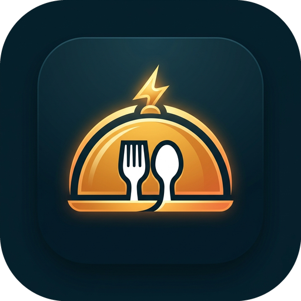
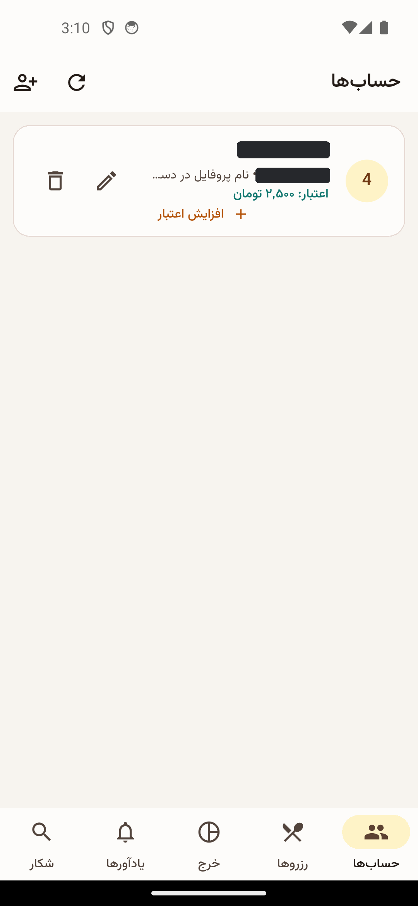
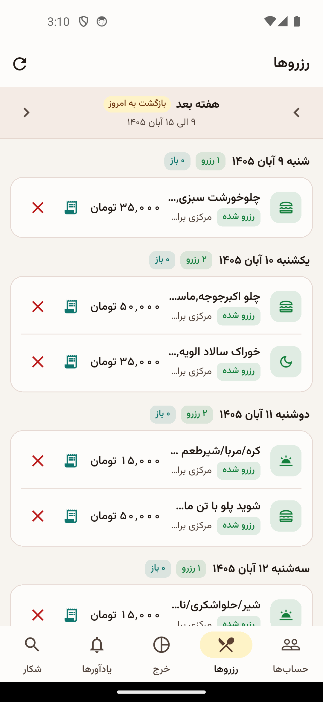
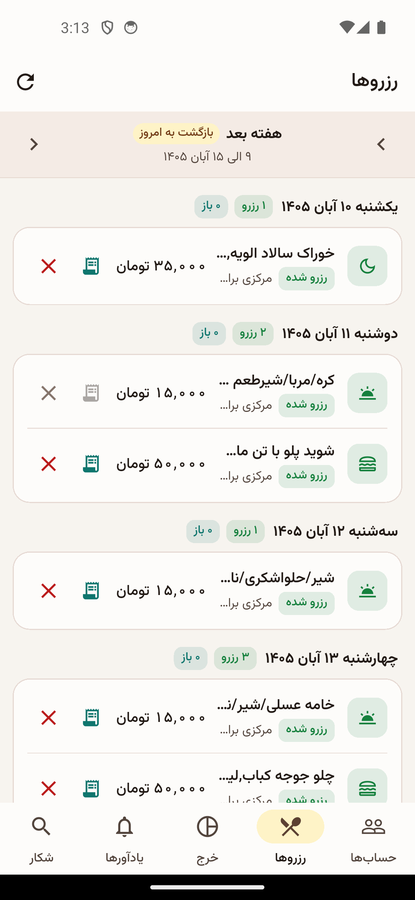
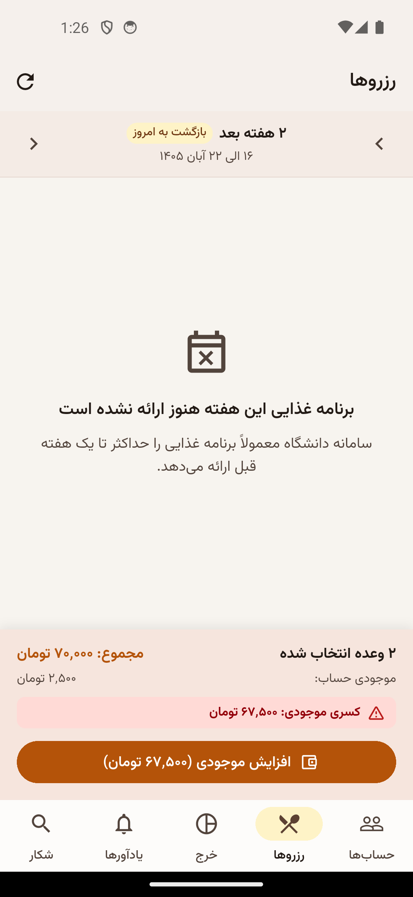
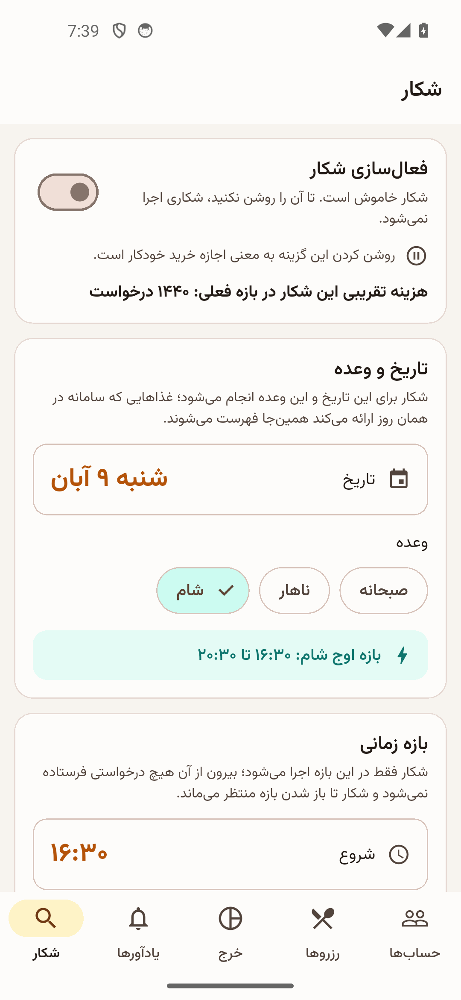
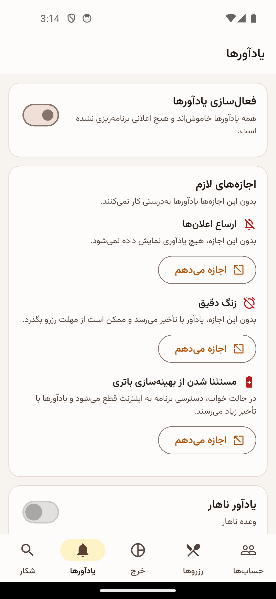
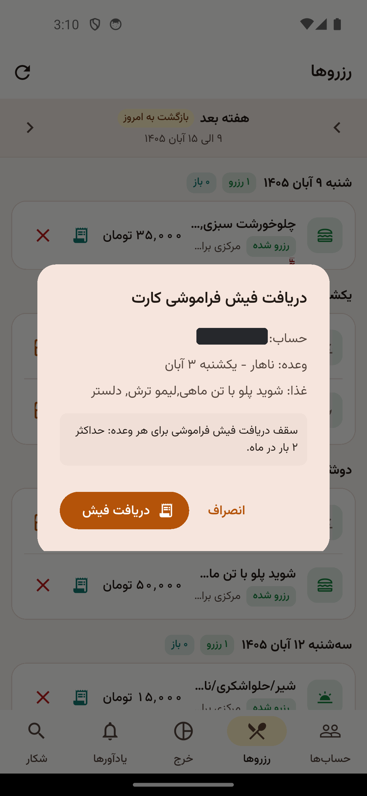
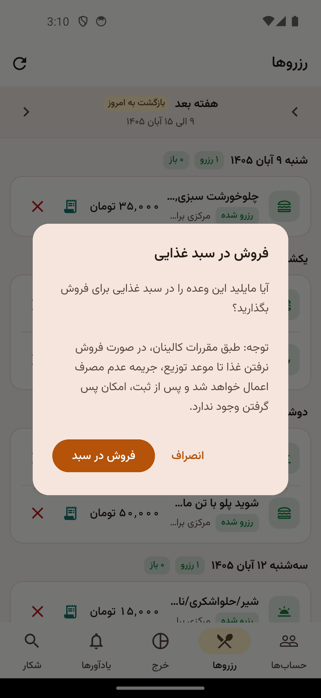
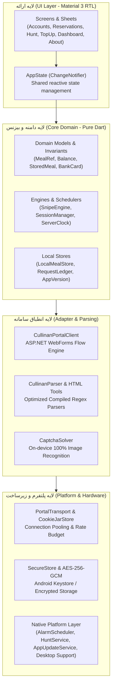

<div align="center">



# سِلفیار — Selfiyar
### دستیار و سامانه هوشمند اتوماسیون تغذیه دانشگاه شهید باهنر کرمان
**Next-Generation Cross-Platform Smart Dining Assistant for Shahid Bahonar University of Kerman (SBUK)**

[](https://github.com/Ashekofteh/Bahonar-Nut/releases/latest)
[](https://github.com/Ashekofteh/Bahonar-Nut/releases)
[](https://flutter.dev)
[](https://dart.dev)
[](https://github.com/Ashekofteh/Bahonar-Nut/actions)
[](LICENSE)

<br/>

[📱 دانلود اندروید](https://github.com/Ashekofteh/Bahonar-Nut/releases/latest/download/selfiyar-beta.apk) &bull;
[🍏 دانلود آی‌او‌اس (iOS)](https://github.com/Ashekofteh/Bahonar-Nut/releases/latest/download/selfiyar-ios.ipa) &bull;
[🪟 دانلود ویندوز](https://github.com/Ashekofteh/Bahonar-Nut/releases/latest/download/selfiyar-windows-x64.zip) &bull;
[🍎 دانلود مک‌اواس](https://github.com/Ashekofteh/Bahonar-Nut/releases/latest/download/selfiyar-macos.zip) &bull;
[🐧 دانلود لینوکس](https://github.com/Ashekofteh/Bahonar-Nut/releases/latest/download/selfiyar-linux-x64.tar.gz) &bull;
[✨ قابلیت‌های کلیدی](#features) &bull;
[📸 تصاویر](#screenshots) &bull;
[🏗️ معماری](#architecture) &bull;
[🛠️ راهنمای توسعه](#development)

</div>

---

## 📖 درباره پروژه (About the Project)

**سِلفیار (Selfiyar)** یک کلاینت مدرن، آفلاین‌محور و چندسکویی (Cross-Platform) با رابط کاربری اختصاصی راست‌به‌چپ (RTL) و طراحی متریال ۳ است که تجربه تعامل دانشجویان دانشگاه شهید باهنر کرمان با سامانه اتوماسیون تغذیه (Cullinan) را متحول می‌سازد. 

این پروژه با عبور از کندی‌ها و محدودیت‌های نسخه وب، امکاناتی فراتر از یک سامانه رزرو معمولی شامل: **شکار خودکار غذاهای پرطرفدار**، **رزرو دسته‌جمعی با تفکیک سلف و غذا**، **حل محلی و بلادرنگ کپچا بدون نیاز به اینترنت**، **مدیریت چند حسابه با شناسایی خودکار هویت**، **به‌روزرسانی بلادرنگ موجودی**، **کیف پول کارت‌های شتاب و شارژ هوشمند کسری اعتبار**، **فیش فراموشی فوری کارت با قابلیت اشتراک‌گذاری پیامکی**، **سبد غذایی ثانویه با قابلیت لغو فروش**، **سامانه هوشمند و محترمانه بروزرسانی**، و **پشتیبانی کامل از تم تاریک و روشن** را در قالبی سبک و امن ارائه می‌دهد.

---

## 🚀 دانلود آخرین نسخه (Download Latest Releases)

| پلتفرم | فایل دانلودی | توضیحات و پیش‌نیاز | وضعیت |
| :--- | :--- | :--- | :---: |
| 📱 **اندروید (Android)** | [**`selfiyar-beta.apk`**](https://github.com/Ashekofteh/Bahonar-Nut/releases/latest/download/selfiyar-beta.apk) | اندروید ۸.۰ به بالا (امضای رسمی با کلید دائمی) | [](#) |
| 🍏 **آی‌او‌اس (iOS IPA)** | [**`selfiyar-ios.ipa`**](https://github.com/Ashekofteh/Bahonar-Nut/releases/latest/download/selfiyar-ios.ipa) | آیفون و آیپد (نصب با Sideloadly / AltStore / استورها) | [](#) |
| 🪟 **ویندوز (Windows x64)** | [**`selfiyar-windows-x64.zip`**](https://github.com/Ashekofteh/Bahonar-Nut/releases/latest/download/selfiyar-windows-x64.zip) | ویندوز ۱۰ و ۱۱ نسخه ۶۴ بیتی (Portable) | [](#) |
| 🍎 **مک‌اواس (macOS)** | [**`selfiyar-macos.zip`**](https://github.com/Ashekofteh/Bahonar-Nut/releases/latest/download/selfiyar-macos.zip) | مک‌اواس ۱۲+ (Apple Silicon و Intel) | [](#) |
| 🐧 **لینوکس (Linux x64)** | [**`selfiyar-linux-x64.tar.gz`**](https://github.com/Ashekofteh/Bahonar-Nut/releases/latest/download/selfiyar-linux-x64.tar.gz) | توزیع‌های ۶۴ بیتی لینوکس (Portable Bundle) | [](#) |

> [!TIP]
> **راهنمای نصب نسخه iOS:** فایل `selfiyar-ios.ipa` را دانلود کرده و به آسانی از طریق ابزار رایگان [**Sideloadly**](https://sideloadly.io/) (در ویندوز یا مک) یا [**AltStore**](https://altstore.io/) با وارد کردن اپل‌آیدی شخصی روی آیفون نصب نمایید. همچنین این فایل در استورهای ایرانی iOS (سیبچه، سیب‌اپ، اناردونی) قابل بارگذاری و نصب مستقیم است.

> [!TIP]
> برای مشاهده تاریخچه نسخه‌ها و تغییرات هر نسخه، به صفحه [**GitHub Releases**](https://github.com/Ashekofteh/Bahonar-Nut/releases) مراجعه کنید.

---

<span id="features"></span>
## 🌟 قابلیت‌های برجسته و کلیدی (Key Features)

### 👥 ۱. مدیریت چند حساب کاربری با شناسایی خودکار هویت
- امکان ذخیره و جابه‌جایی سریع میان حساب‌های کاربری متعدد با نگهداری کوکی‌های مجزا و ایزوله.
- **استخراج خودکار نام دانشجو:** در صورتی که کاربر نام حساب را به صورت دستی وارد نکند، برنامه نام و نام خانوادگی واقعی دانشجو را در اولین اتصال از پورتال استخراج کرده و به صورت دائمی ثبت می‌کند.
- **به‌روزرسانی بلادرنگ موجودی:** موجودی ریالی حساب‌ها و نوار بالای صفحه بلافاصله پس از انجام رزرو، لغو رزرو یا افزایش موجودی به صورت زنده و خودکار همگام‌سازی می‌شود.

### 🍽️ ۲. رزرو دسته‌جمعی غذاها با انتخاب دقیق سلف و نوع غذا
- رزرو سریع چندین وعده به طور همزمان با یک ضربه.
- برگه اختصاصی تنظیمات رزرو گروهی جهت تعیین سلف تحویل (مرکزی، مهندسی و ...) و انتخاب از میان غذاهای چندگزینه‌ای به ازای هر روز یا به صورت سراسری.
- ناوبری هوشمند دو هفته‌ای (هفته جاری و هفته آینده) با قابلیت فوکوس خودکار روی هفته‌های دارای غذای باز.

### 🎯 ۳. موتور خودکار شکار وعده (Food Hunt Engine)
- مانیتورینگ خودکار ظرفیت‌های آزاد شده در پورتال بر اساس ترجیحات و اولویت‌های تعیین‌شده دانشجو (نوع غذا و سلف‌های هدف).
- نرخ پولینگ بهینه و هوشمند بر مبنای ساعات اوج و غیراوج به منظور جلوگیری از فشار به سرور دانشگاه یا مسدودی آی‌پی.
- اجرای مستقل به عنوان فورگراند سرویس با معافیت بهینه‌سازی باتری در اندروید (`BatteryExemption`) و توقف فوری پردازش به محض شکار موفق.

### ⚡ ۴. حل‌کننده درون‌دستگاهی کپچا (On-Device CAPTCHA Solver)
- الگوریتم اختصاصی بینایی ماشین مبتنی بر تحلیل تفاضل شدت روشنایی و تطبیق الگو (Nearest-Template Matching).
- **دقت ۱۰۰٪ با زمان اجرای زیر ۱ میلی‌ثانیه**، بدون نیاز به ارسال تصویر به سرورهای خارجی، بدون مصرف ترافیک اینترنت و بدون وابستگی به فیلترشکن.

### 💳 ۵. صندوق کارت‌های شتاب و شارژ هوشمند کسری موجودی
- تشخیص خودکار مبلغ کسری موجودی هنگام رزرو تکی یا چندگانه و پیش‌فرض قرار دادن مبلغ به تومان در برگه افزایش اعتبار.
- ذخیره‌سازی محلی و امن اطلاعات کارت‌های بانکی دانشجو با امکان تکمیل خودکار فرم درگاه پرداخت (شماره کارت، تاریخ انقضا و CVV2).
- سازوکار خودکار «استعلام و بازگشت» جهت ثبت قطعی افزایش اعتبار در سامانه کالینان پس از پرداخت، حتی در صورت قطعی اینترنت در صفحه بانک.
- **رزرو خودکار پس از شارژ:** ثبت خودکار وعده‌های معلق بلافاصله پس از تکمیل موفقیت‌آمیز افزایش موجودی.

### 🧾 ۶. فیش فراموشی فوری کارت تغذیه (Instant Forgot Voucher)
- دریافت بلادرنگ بارکد و کد شناسه فیش فراموشی موقت جهت تحویل غذا از سلف بدون نیاز به کارت فیزیکی همراه با قابلیت کپی سریع.
- **اشتراک‌گذاری آسان فیش:** امکان ارسال و اشتراک‌گذاری مستقیم شناسه فیش و مشخصات غذا از طریق پیامک (SMS) یا پیام‌رسان‌ها جهت دریافت غذا توسط دوستان در زمان غیبت دانشجو.

### 🍱 ۷. سبد غذایی ثانویه (خرید و فروش مازاد)
- سازگاری کامل با بخش `FoodBasketBuy` و `FoodBasketSale` جهت خرید غذاهای حراجی یا ثبت و عرضه وعده‌های رزروشده جهت جلوگیری از هدررفت ژتون.
- **نمایش پویای وضعیت و امکان لغو فروش:** تغییر خودکار نماد و وضعیت غذا در جدول پس از ثبت در سبد، همراه با امکان انصراف و حذف غذا از سبد فروش تا پیش از خرید توسط سایر دانشجویان.

### 📊 ۸. داشبورد مالی، آمار مصرف و یادآورهای هوشمند
- نمایش نمودار هزینه‌کرد و تراکنش‌ها به تفکیک وعده‌های صبحانه، ناهار و شام با فیلترهای زمانی دوره‌ای متنوع.
- یادآورهای اعلام وعده و تلنگر رزرو هفته آینده با بهره‌گیری از `AlarmManager` سخت‌افزاری اندروید با **مصرف باتری صفر در حالت استندبای**.
- سازوکار بررسی آنلاین و پایش تغییرات رزرو با کلید فعال‌سازی اختصاصی در صفحه یادآورها.

### 🎨 ۹. طراحی مدرن چندسکویی و تم دوگانه (Cross-Platform & Material 3)
- طراحی استاندارد مبتنی بر اصول **Material 3** با تایپوگرافی اصیل و خوانای فارسی (فونت وزیرمتن).
- پشتیبانی کامل و یکپارچه از پوسته تاریک و روشن (Dark / Light Mode) در تمامی بخش‌ها و صفحات.
- بسته‌های اجرایی سبک، سریع و بومی برای هر ۵ پلتفرم اصلی: **اندروید (Android)**، **آی‌او‌اس (iOS)**، **ویندوز (Windows Desktop)**، **مک‌اواس (macOS)** و **لینوکس (Linux Desktop)**.

### 🔄 ۱۰. سامانه هوشمند و غیرمزاحم بروزرسانی (In-App Polite Updater)
- استعلام سبک و مستقیم نسخه جدید از فایل متنی `version.json` روی CDN گیت‌هاب بدون محدودیت سقف درخواست (Zero Rate-Limit) در شبکه مشترک دانشگاه.
- مجهز به مکانیزم Throttling با استعلام خودکار حداکثر هر ۲۴ ساعت یک‌بار جهت محافظت از ترافیک اینترنت کاربر.
- **عدم مزاحمت در لحظات حساس:** عدم نمایش هرگونه پنجره پاپ‌آپ مسدودکننده در هنگام باز کردن برنامه و استفاده از نشانگر ملایم روی آیکون اطلاعات.
- امکان نادیده گرفتن نسخه جاری (**Skip this version**) و دانلود مستقیم پکیج اختصاصی هر سیستم‌عامل از طریق مرورگر بومی.

### ℹ️ ۱۱. بخش «درباره سِلفیار» و جامعه متن‌باز (About & Open Source)
- دسترسی سریع از نوار بالای صفحه (AppBar) بدون اشغال فضای کاری رزرو غذا.
- دیالوگ استاندارد متریال ۳ شامل اطلاعات نسخه، دکمه بررسی دستی بروزرسانی، ارجاع مستقیم به صفحه گیت‌هاب توسعه‌دهنده (`Ashekofteh`) و مخزن آزاد پروژه.
- لینک مستقیم به بخش ثبت باگ و پیشنهادات در GitHub Issues.

### 🧭 ۱۲. راهنمای تعاملی شروع کار (Interactive Onboarding)
- طراحی کاروسل ۴ اسلایدی در اولین ورود جهت آشنایی سریع با امکانات کلیدی.
- تاکید صریح بر لزوم فشردن دکمه رفرش (🔄) در اولین ورود به صفحه رزرو برای بارگذاری منوی جدید غذاها و سلف‌ها.
- امکان رد شدن سریع (Skip) و عدم نمایش مجدد، همراه با دسترسی همیشگی از بخش درباره برنامه.

---

<span id="screenshots"></span>
## 📸 گالری تصاویر برنامه (Screenshots)

<div align="center">

| مدیریت حساب‌ها | جدول رزرو هفتگی | جزئیات رزرو دسته‌جمعی |
| :---: | :---: | :---: |
|  |  |  |

| شارژ هوشمند و کارت‌ها | موتور شکار غذا (Hunt) | یادآورها و اعلان‌ها |
| :---: | :---: | :---: |
|  |  |  |

| داشبورد آمار و هزینه‌ها | فیش فراموشی کارت | ثبت غذا برای فروش |
| :---: | :---: | :---: |
|  |  |  |

</div>

---

<span id="architecture"></span>
## 🏗️ معماری نرم‌افزار و اصول فنی (Architecture)

سِلفیار بر اساس معماری چندلایه پاک (Clean Layered Architecture) پیاده‌سازی شده و از وابستگی‌های غیرضروری کاملاً پیراسته است:



### 🔒 امنیت و حریم خصوصی (Privacy & Security First)
- **رمزنگاری سخت‌افزاری:** کلیه گذرواژه‌ها و شماره کارت‌ها با استفاده از الگوریتم **AES-256-GCM** ذخیره شده و هرگز در فایل‌های متنی ساده قرار نمی‌گیرند.
- **ارتباط ایزوله کوکی‌ها:** هر حساب کاربری در کانتینر کوکی مستقل (`CookieJarStore`) نگهداری می‌شود و هیچ تداخل یا نشت نشستی میان حساب‌ها وجود ندارد.
- **ترافیک مستقیم دانشگاه:** کلیه درخواست‌ها مستقیماً و منحصراً میان دستگاه دانشجو و سرورهای رسمی دانشگاه (`nut.uk.ac.ir`) رد و بدل می‌شوند؛ هیچ سرور واسط یا سرور پروکسی وجود ندارد.

---

<span id="development"></span>
## 🛠️ راهنمای توسعه و کامپایل (Development & Build)

### پیش‌نیازها
- **Flutter SDK:** نسخه `^3.13.5` یا جدیدترین نسخه Stable
- **Android SDK:** حداقل API 24 (اندروید ۷+) و Target API 36
- **ابزارهای دسکتاپ و iOS:**
  - **ویندوز:** Visual Studio با ورک‌لود Desktop development with C++
  - **مک‌اواس و iOS:** macOS با آخرین نسخه Xcode و ابزار Command Line Tools
  - **لینوکس:** `clang`, `cmake`, `ninja-build`, `pkg-config`, `libgtk-3-dev`

### راه‌اندازی و اجرای سورس

1. **کلون مخزن:**
   ```bash
   git clone https://github.com/Ashekofteh/Bahonar-Nut.git
   cd Bahonar-Nut
   ```

2. **دریافت پکیج‌ها:**
   ```bash
   flutter pub get
   ```

3. **بررسی صحت کد و تحلیل ایستا:**
   ```bash
   dart analyze lib/
   ```

4. **اجرای آزمون‌های خودکار:**
   ```bash
   flutter test
   ```

5. **کامپایل خروجی رسمی:**
   ```bash
   # کامپایل نسخه اندروید
   flutter build apk --release

   # کامپایل نسخه ویندوز
   flutter build windows --release

   # کامپایل نسخه مک‌اواس
   flutter build macos --release

   # کامپایل نسخه لینوکس
   flutter build linux --release

   # کامپایل نسخه آی‌او‌اس
   flutter build ios --release --no-codesign
   ```

---

## 🤝 مشارکت و توسعه (Contributing)

مشارکت‌ها، پیشنهادات و گزارش اشکالات به گرمی استقبال می‌شوند! لطفاً پیش از ارسال Pull Request، فایل [**CONTRIBUTING.md**](CONTRIBUTING.md) را مطالعه کرده و اطمینان حاصل کنید که کلیه تست‌های پروژه با موفقیت پاس می‌شوند.

---

## 📜 مجوز (License)

این پروژه تحت مجوز متن‌باز [**MIT License**](LICENSE) منتشر شده است و استفاده، شخصی‌سازی و بازنشر آن با رعایت شرایط این مجوز کاملاً آزاد است.

---

<div align="center">
  <sub>طراحی و توسعه‌یافته با ❤️ برای دانشجویان و جامعه دانشگاهی دانشگاه شهید باهنر کرمان</sub>
</div>
